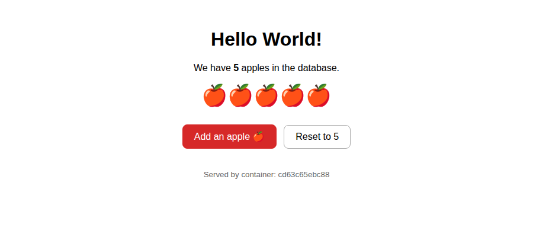
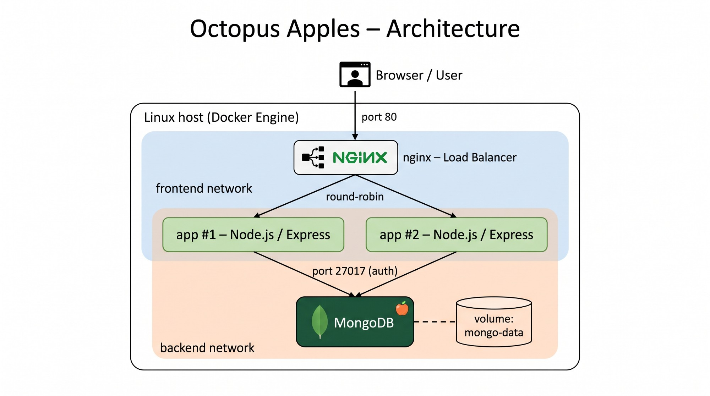
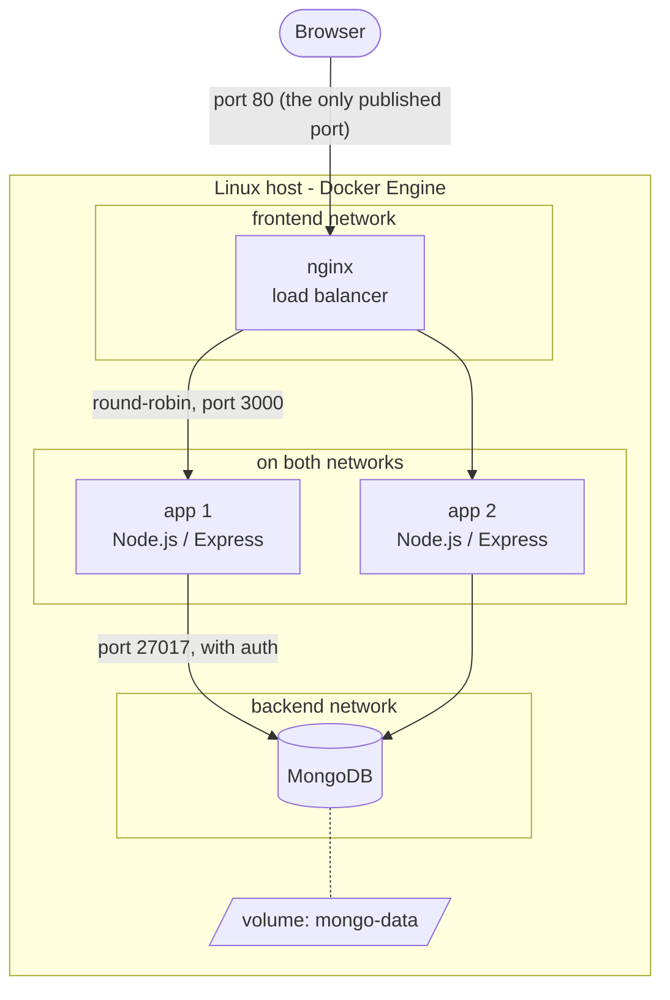

# Octopus Apples 🍎

A "Hello World" web page that shows how many apples are stored in a MongoDB
database. It runs as four containers: an nginx load balancer, two Node.js
app replicas and MongoDB. The whole thing is provisioned with one script.



## Quick start

Requirements: a Linux host with `git`, `curl`, and port 80 free.
Docker is installed automatically if it is missing (this needs `sudo`).

```bash
git clone https://github.com/TomKoren1/octopuscs_home_assignment.git
cd octopuscs_home_assignment
./provision.sh            # build, start, wait until healthy, smoke-test
```

Then open <http://localhost>.

| Command | What it does |
|---|---|
| `./provision.sh` | Provisions the whole architecture from scratch and checks the result |
| `./topology.sh` | Prints the live containers, networks, IPs and volumes, and shows the load balancer at work |
| `./teardown.sh` | Removes everything: containers, networks, the data volume and the built image (`--keep-data` keeps the volume) |

If port 80 is taken: `HTTP_PORT=8080 ./provision.sh`.

## Architecture



The same diagram as code (GitHub renders it):



### How a request flows

1. The browser connects to port 80 on the host. That is the only port the
   stack publishes.
2. nginx forwards the request to one of the app replicas, alternating between
   them (round-robin).
3. The app reads the `apples` document from MongoDB and renders the page,
   including the hostname of the container that served it.
4. Clicking **Add an apple** sends `POST /apples`. The app increments the count
   in MongoDB and redirects back to `/`.

### Network isolation

| From \ To | nginx | app | MongoDB |
|---|---|---|---|
| Host / Internet | ✅ port 80 | ❌ | ❌ |
| nginx | – | ✅ | ❌ cannot even resolve the name |
| app | – | – | ✅ |

The app containers are the only ones on both networks. Even if nginx were
compromised, it would have no network path to the database.

## Components

### nginx: load balancer (`nginx/default.conf`)

- Official `nginx:1.28-alpine` image with one config file mounted read-only.
- `upstream app_servers { server app:3000 resolve; }`: Docker's internal DNS
  returns one IP per `app` replica, and nginx balances across all of them.
- `resolver 127.0.0.11 valid=5s`: nginx re-asks Docker's DNS every 5 seconds,
  so scaling the app up or down needs no nginx reload.
- `proxy_next_upstream`: if a replica is down, the request is retried on the
  next one, so the user does not see an error.
- `/nginx-health` is answered by nginx itself and used by its healthcheck.

### app: Node.js (`app/`)

- Express 5 and the official `mongodb` driver. All configuration comes from
  environment variables.
- One shared `MongoClient` with a connection pool. It reconnects by itself if
  the database restarts.
- Routes:

  | Route | Purpose |
  |---|---|
  | `GET /` | The page: the apple count, one 🍎 per apple (capped at 50), and the serving container |
  | `POST /apples` | Adds one apple with MongoDB's atomic `$inc` |
  | `POST /apples/reset` | Sets the count back to 5 |
  | `GET /health` | Pings MongoDB; returns 200 or 503. Used by the Docker healthcheck |

- Handles `SIGTERM`: finishes in-flight requests and closes the DB connection,
  so `docker stop` takes milliseconds instead of a 10-second kill.
- Dockerfile: `node:24-alpine` base, `npm ci` from the lockfile in its own
  cached layer, runs as the non-root `node` user.

### MongoDB (`mongo/init/01-seed.js`)

- Official `mongo:8.0` image. Data lives in the named volume `mongo-data`.
- Authentication is on. The root user and password come from `.env`, which
  `provision.sh` generates with a random password on first run.
- On first boot with an empty volume, the image runs every script in
  `/docker-entrypoint-initdb.d/`. Our script seeds the `store.fruits`
  collection:

  ```js
  [
    { _id: 1, name: "apples",   qty: 5, rating: 3 },
    { _id: 2, name: "bananas",  qty: 7, rating: 1, microsieverts: 0.1 },
    { _id: 3, name: "oranges",  qty: 6, rating: 2 },
    { _id: 4, name: "avocados", qty: 3, rating: 5 }
  ]
  ```

  The data in the assignment has a trailing comma, which is not valid JSON;
  it is removed here.

### Startup order

Every container has a healthcheck, and each one waits for the previous one
to be **healthy**, not just started:

```
mongo (healthy) ──► app ×2 (healthy) ──► nginx (healthy) ──► smoke test
```

## Design decisions

| Decision | Why |
|---|---|
| **Docker Compose, not Kubernetes** | The assignment asks for containers on one Linux host. Compose describes the whole stack in one file and is easy to read and explain. Kubernetes would add a lot of moving parts and no benefit at this size. |
| **Two networks** | Network segmentation: only the app tier can reach the database. |
| **Only nginx publishes a port** | The smallest possible attack surface. |
| **Two app replicas** | Demonstrates load balancing and shows that the app tier is *stateless*: all state is in MongoDB, so any replica can serve any request. |
| **Seed through the Mongo init script** | Built into the official image, with no extra container. It runs only on an empty volume, so restarts never duplicate data. |
| **Secrets in `.env`, injected at runtime** | The password is never committed to git and never baked into an image. `.env.example` documents the variables. |
| **Healthchecks and `depends_on: service_healthy`** | Removes the race where the app starts before the database is ready. |
| **Pinned image versions and a lockfile** | The same build today and on the reviewer's machine. |
| **Atomic `$inc` for the button** | Two replicas updating at the same moment never lose a click. Tested with 40 parallel requests. |

## Testing and demo

### Automatic smoke test

The last phase of `provision.sh` reads the apple count directly from MongoDB
and checks that the web page shows the same number. It fails with a non-zero
exit code if they differ, so it also works as a CI/CD gate.

### Things to try

```bash
# Load balancing: the container ID alternates
for i in 1 2 3 4; do curl -s localhost | grep -o 'container: [0-9a-f]*'; done

# Failover: stop one replica, the page keeps working
docker stop octopus-apples-app-1 && curl -s localhost | grep -o 'container: [0-9a-f]*'
docker start octopus-apples-app-1

# Scale without touching nginx
docker compose up -d --scale app=3 --wait

# Data survives a restart; init scripts do not run again
docker compose restart mongo

# Network isolation: nginx cannot reach MongoDB
docker compose exec nginx nc -zw2 mongo 27017   # "bad address 'mongo'"
```

## Repository layout

```
.
├── provision.sh           # one-command provisioning + smoke test
├── topology.sh            # live view of containers, networks, volumes
├── teardown.sh            # remove everything
├── docker-compose.yml     # the whole architecture
├── .env.example           # variables; provision.sh copies it to .env
├── app/
│   ├── Dockerfile
│   ├── .dockerignore
│   ├── package.json
│   ├── package-lock.json
│   └── server.js          # the Node.js app
├── mongo/init/
│   └── 01-seed.js         # seed data, runs on first boot
├── nginx/
│   └── default.conf       # load balancer config
└── docs/                  # images used in this README
```

## Known limitations and production next steps

This is sized for a home assignment. In production I would change:

- **Single points of failure:** one nginx and one MongoDB. Use a managed load
  balancer (for example an AWS ALB) and a MongoDB replica set or a managed
  database.
- **The app uses the MongoDB root user.** Create a dedicated user with access
  to the `store` database only (least privilege).
- **No HTTPS.** Terminate TLS at the load balancer.
- **Passive health checks only:** nginx detects a dead replica when a request
  to it fails. A cloud load balancer probes `/health` actively.
- **Secrets in a file.** Use a secrets manager (for example AWS Secrets Manager).
- **No monitoring.** Add metrics and central logs.

## CI/CD on AWS

*Coming in the next step.*
