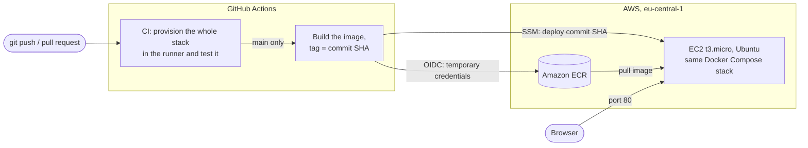

# Octopus Apples 🍎

A "Hello World" web page that shows how many apples are stored in a MongoDB
database. It runs as four containers: an nginx load balancer, two Node.js
app replicas and MongoDB. The whole thing is provisioned with one script.


## Quick start

Requirements: a Linux host with `git`, `curl`, and port 80 free.
Docker is installed automatically if it is missing, with Docker's official
install script (this needs `sudo`).

```bash
git clone https://github.com/TomKoren1/octopuscs_home_assignment.git
cd octopuscs_home_assignment
./provision.sh            # build, start, wait until healthy, smoke-test
```

Then open <http://localhost>.

| Command | What it does |
|---|---|
| `./provision.sh` | Provisions the whole architecture from scratch and checks the result |
| `./topology.sh` | Prints the live containers, networks, IPs and volumes, and shows the load balancer at work |
| `./teardown.sh` | Removes everything: containers, networks, the data volume and the built image (`--keep-data` keeps the volume) |

If port 80 is taken: `HTTP_PORT=8080 ./provision.sh`.

## Architecture


The same diagram as code (GitHub renders it):


### How a request flows

1. The browser connects to port 80 on the host. That is the only port the
   stack publishes.
2. nginx forwards the request to one of the app replicas, alternating between
   them (round-robin).
3. The app reads the `apples` document from MongoDB and renders the page,
   including the hostname of the container that served it.
4. Clicking **Add an apple** sends `POST /apples`. The app increments the count
   in MongoDB and redirects back to `/`.

### Network isolation

| From \ To | nginx | app | MongoDB |
|---|---|---|---|
| Host / Internet | ✅ port 80 | ❌ | ❌ |
| nginx | – | ✅ | ❌ cannot even resolve the name |
| app | – | – | ✅ |

The app containers are the only ones on both networks. Even if nginx were
compromised, it would have no network path to the database.

## Components

### nginx: load balancer (`nginx/default.conf`)

- Official `nginx:1.28-alpine` image with one config file mounted read-only.
- `upstream app_servers { server app:3000 resolve; }`: Docker's internal DNS
  returns one IP per `app` replica, and nginx balances across all of them.
- `resolver 127.0.0.11 valid=5s`: nginx re-asks Docker's DNS every 5 seconds,
  so scaling the app up or down needs no nginx reload.
- `proxy_next_upstream`: if a replica is down, the request is retried on the
  next one, so the user does not see an error.
- `/nginx-health` is answered by nginx itself and used by its healthcheck.

### app: Node.js (`app/`)

- Express 5 and the official `mongodb` driver. All configuration comes from
  environment variables.
- One shared `MongoClient` with a connection pool. It reconnects by itself if
  the database restarts.
- Routes:

  | Route | Purpose |
  |---|---|
  | `GET /` | The page: the apple count, one 🍎 per apple (capped at 50), and the serving container |
  | `POST /apples` | Adds one apple with MongoDB's atomic `$inc` |
  | `POST /apples/reset` | Sets the count back to 5 |
  | `GET /health` | Pings MongoDB; returns 200 or 503. Used by the Docker healthcheck |

- Handles `SIGTERM`: finishes in-flight requests and closes the DB connection,
  so `docker stop` takes milliseconds instead of a 10-second kill.
- Dockerfile: `node:24-alpine` base, `npm ci` from the lockfile in its own
  cached layer, runs as the non-root `node` user.

### MongoDB (`mongo/init/01-seed.js`)

- Official `mongo:8.0` image. Data lives in the named volume `mongo-data`.
- Authentication is on. The root user and password come from `.env`, which
  `provision.sh` generates with a random password on first run.
- On first boot with an empty volume, the image runs every script in
  `/docker-entrypoint-initdb.d/`. Our script seeds the `store.fruits`
  collection:

  ```js
  [
    { _id: 1, name: "apples",   qty: 5, rating: 3 },
    { _id: 2, name: "bananas",  qty: 7, rating: 1, microsieverts: 0.1 },
    { _id: 3, name: "oranges",  qty: 6, rating: 2 },
    { _id: 4, name: "avocados", qty: 3, rating: 5 }
  ]
  ```

  The data in the assignment has a trailing comma, which is not valid JSON;
  it is removed here.

### Startup order

Every container has a healthcheck, and each one waits for the previous one
to be **healthy**, not just started:

```
mongo (healthy) ──► app ×2 (healthy) ──► nginx (healthy) ──► smoke test
```

## Design decisions

| Decision | Why |
|---|---|
| **Docker Compose, not Kubernetes** | The assignment asks for containers on one Linux host. Compose describes the whole stack in one file and is easy to read and explain. Kubernetes would add a lot of moving parts and no benefit at this size. |
| **Two networks** | Network segmentation: only the app tier can reach the database. |
| **Only nginx publishes a port** | The smallest possible attack surface. |
| **Two app replicas** | Demonstrates load balancing and shows that the app tier is *stateless*: all state is in MongoDB, so any replica can serve any request. |
| **Seed through the Mongo init script** | Built into the official image, with no extra container. It runs only on an empty volume, so restarts never duplicate data. |
| **Secrets in `.env`, injected at runtime** | The password is never committed to git and never baked into an image. `.env.example` documents the variables. |
| **Healthchecks and `depends_on: service_healthy`** | Removes the race where the app starts before the database is ready. |
| **Pinned image versions and a lockfile** | The same build today and on the reviewer's machine. |
| **Atomic `$inc` for the button** | Two replicas updating at the same moment never lose a click. Tested with 40 parallel requests. |

## Testing and demo

### Automatic smoke test

The last phase of `provision.sh` reads the apple count directly from MongoDB
and checks that the web page shows the same number. It fails with a non-zero
exit code if they differ, so it also works as a CI/CD gate.

### Things to try

```bash
# Load balancing: the container ID alternates
for i in 1 2 3 4; do curl -s localhost | grep -o 'container: [0-9a-f]*'; done

# Failover: stop one replica, the page keeps working
docker stop octopus-apples-app-1 && curl -s localhost | grep -o 'container: [0-9a-f]*'
docker start octopus-apples-app-1

# Scale without touching nginx
docker compose up -d --scale app=3 --wait

# Data survives a restart; init scripts do not run again
docker compose restart mongo

# Network isolation: nginx cannot reach MongoDB
docker compose exec nginx nc -zw2 mongo 27017   # "bad address 'mongo'"
```

## Extras beyond the assignment

A few small additions I made along the way:

- **Add-apple and reset buttons.** The count changes in MongoDB, so any
  replica shows the same number. The update uses `$inc`, which is atomic.
- **Version label.** The page footer and `/health` show which commit is
  running.
- **Smoke test that compares with the database.** `provision.sh` checks that
  the page shows the same number MongoDB holds, not a hard-coded 5.
- **Failover test in CI.** One replica is stopped and the page must keep
  working.
- **Deploy without keys or SSH.** GitHub logs in to AWS with OIDC, and the
  server is reached only through SSM.

The CI/CD work was added through pull requests
([#1](https://github.com/TomKoren1/octopuscs_home_assignment/pull/1),
[#2](https://github.com/TomKoren1/octopuscs_home_assignment/pull/2)).

## Repository layout

```
.
├── provision.sh               # one-command provisioning + smoke test
├── topology.sh                # live view of containers, networks, volumes
├── teardown.sh                # remove everything
├── docker-compose.yml         # the whole architecture
├── docker-compose.deploy.yml  # override used on the server: run the image built by CI
├── .env.example               # variables; provision.sh copies it to .env
├── app/
│   ├── Dockerfile
│   ├── .dockerignore
│   ├── package.json
│   ├── package-lock.json
│   └── server.js              # the Node.js app
├── mongo/init/
│   └── 01-seed.js             # seed data, runs on first boot
├── nginx/
│   └── default.conf           # load balancer config
├── .github/workflows/
│   └── ci-cd.yml              # the pipeline: test, build, push, deploy
├── infra/                     # Terraform: everything on AWS
│   ├── apply.sh / destroy.sh  # create / delete the infrastructure
│   ├── network.tf             # VPC, subnet, internet gateway, firewall
│   ├── ec2.tf                 # the server and its role
│   ├── user_data.sh.tftpl     # the server's first-boot script
│   ├── ecr.tf                 # image registry
│   └── deploy.tf              # GitHub OIDC role + the SSM deploy document
└── docs/                      # images used in this README
```

## Known limitations and production next steps

This is sized for a home assignment. In production I would change:

- **Single points of failure:** one nginx and one MongoDB. Use a managed load
  balancer (for example an AWS ALB) and a MongoDB replica set or a managed
  database.
- **The app uses the MongoDB root user.** Create a dedicated user with access
  to the `store` database only (least privilege).
- **No HTTPS.** Terminate TLS at the load balancer.
- **Passive health checks only:** nginx detects a dead replica when a request
  to it fails. A cloud load balancer probes `/health` actively.
- **Secrets in a file.** Use a secrets manager (for example AWS Secrets Manager).
- **No monitoring.** Add metrics and central logs.
- **A deploy causes a few seconds of errors**, because Compose replaces both
  app replicas at once. A rolling update (start a new replica, wait until it
  is healthy, then remove an old one) would make it zero-downtime.

## CI/CD on AWS

Every push is tested, and every push to `main` is deployed to a server on
AWS. The pipeline is `.github/workflows/ci-cd.yml`; the AWS side is Terraform
in `infra/`.



### What the pipeline does

| Job | When | Steps |
|---|---|---|
| **Provision and test** (CI) | every pull request and every push | Runs `./provision.sh` inside the GitHub runner, so the real stack starts from scratch. Then tests the buttons, the version label, and that the page survives one replica going down. |
| **Deploy to AWS** (CD) | pushes to `main`, after CI passed | 1. Logs in to AWS with OIDC. 2. Builds the image and pushes it to ECR, tagged with the commit SHA. 3. Tells the server, through AWS SSM, to deploy that SHA. 4. Checks that the live site reports that exact SHA. |

The page footer and `/health` show the running version, so you can always
see which commit is live.

### What Terraform creates

| Resource | Purpose |
|---|---|
| VPC, public subnet, internet gateway, route table | A small network of its own. No NAT gateway, which would cost money. |
| Security group | Inbound port 80 only. **There is no SSH port.** |
| EC2 instance (`t3.micro`, Ubuntu 24.04) | Runs the same Compose stack. On first boot it installs Docker from Ubuntu's packages (they include the ECR credential helper, and mixing them with Docker's own packages breaks the daemon), clones this repo and runs `./provision.sh`. |
| Instance role | Lets SSM manage the server and lets it pull from ECR. No keys on disk. |
| ECR repository | Immutable tags, scan on push, keeps the last 5 images. |
| SSM document | The fixed deploy script. Its only input is a 40-character commit SHA. |
| GitHub OIDC role | Can be assumed only by this repository's `main` branch. May only push to this ECR repository and start this one SSM document on this one instance. |

### Security choices

- **No AWS keys in GitHub.** The job proves who it is with a short-lived OIDC
  token and receives temporary credentials.
- **No SSH.** Deploys and shell access go through AWS SSM, which is
  authenticated with IAM and logged.
- **The pipeline cannot run arbitrary commands on the server.** It can only
  ask for "deploy commit X".
- **The database password never leaves the server.** `provision.sh` generates
  it there; GitHub and Terraform never see it.
- **Build once.** The server runs the image CI built and tested, not a rebuild.
- **Actions are pinned to commit hashes**, not to movable version tags.

### Run it yourself

You need Terraform, the AWS CLI with credentials, and the GitHub CLI (`gh`).

```bash
cd infra
cp terraform.tfvars.example terraform.tfvars   # optional: adjust the settings
./apply.sh       # create everything, connect the pipeline, wait for the site
./destroy.sh     # delete everything again
```

`apply.sh` stores Terraform's outputs (role, region, instance, URL) as GitHub
repository *variables*. None of them is secret. While they exist, pushes to
`main` are deployed; `destroy.sh` removes them, and the deploy job is then
skipped.

### Cost

Running it for a few days costs cents, which the AWS free tier or free-plan
credits cover. `./destroy.sh` removes all of it.
Terraform state is a local file, so nothing is left in the account.
